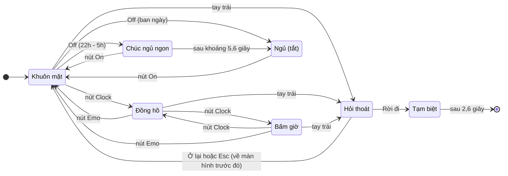
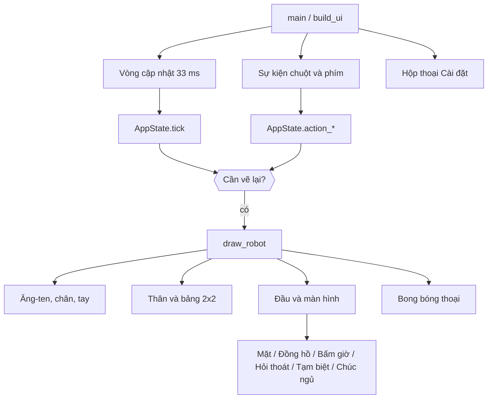

# 🤖 Kai — Robot nhỏ offline mang tính giải trí 

**Một chú robot nhỏ sống trên desktop Ubuntu / GNOME của bạn.**
Biết chào theo buổi, chớp mắt, ngáp, vẫy tay, đổi biểu cảm, xem giờ, bấm giờ — và nhắc bạn đi ngủ.


<!-- Thêm ảnh chụp màn hình tại đây, ví dụ:  -->

</div>

---

## 📑 Mục lục

1. [Nhìn nhanh](#-nhìn-nhanh)
2. [Tính năng chính](#-tính-năng-chính)
3. [Cách điều khiển](#-cách-điều-khiển)
4. [Các màn hình và sơ đồ chuyển trạng thái](#-các-màn-hình-và-sơ-đồ-chuyển-trạng-thái)
5. [Biểu cảm](#-biểu-cảm)
6. [Hành vi tự động](#-hành-vi-tự-động)
7. [Cài đặt và file cấu hình](#-cài-đặt-và-file-cấu-hình)
8. [Kiến trúc mã nguồn](#-kiến-trúc-mã-nguồn)
9. [Build và cài đặt](#-build-và-cài-đặt)
10. [Xử lý sự cố](#-xử-lý-sự-cố)
11. [Có gì mới ở bản này](#-có-gì-mới-ở-bản-này)

---

## 👀 Nhìn nhanh

```
              ◉         ◉            ← ăng-ten (đổi dáng theo cảm xúc)
               ╲       ╱
          ┌─────────────────┐
          │ ┌─────────────┐ │
          │ │  ^       ^  │ │        ← MÀN HÌNH MẶT
          │ │      ‿      │ │          biểu cảm · đồng hồ · bấm giờ
          │ └─────────────┘ │          hỏi thoát · chúc ngủ ngon
          └────────┬────────┘
                ┌──┴──┐
   ┌────┐   ┌───┴─────┴───┐   ┌────┐
   │ E  │   │ [On]  [Off] │   │ ⚙  │
   │ ·· │   │ [Emo] [Clock]│  │ ·· │  ← BẢNG ĐIỀU KHIỂN 2×2
   └────┘   └─────────────┘   └────┘
  TAY TRÁI                    TAY PHẢI
  (đinh tán chữ E)            (đinh tán bánh răng)
  → thoát Kai                 → mở Cài đặt
```

| Thành phần | Vai trò |
|---|---|
| 💬 **Bong bóng thoại** | Hiện phía trên đầu: lời chào, nhắc nhở, hỏi thoát |
| 📺 **Màn hình mặt** | Một "màn hình" duy nhất đổi nội dung theo chế độ |
| 🔘 **Bảng 2×2 ở bụng** | `On` · `Off` · `Emo` · `Clock` |
| 🦾 **Hai cánh tay** | Trái = thoát, phải = cài đặt (cả hai làm bằng đinh tán) |
| 🪟 **Cửa sổ** | Không viền, nền trong suốt, kéo thả được |

---

## ✨ Tính năng chính

- 🎭 **9 biểu cảm** + các hành vi nhỏ ngẫu nhiên (suy nghĩ, ngáp, vẫy tay trái).
- 👋 **Chào theo buổi**: sáng · trưa · chiều · tối · khuya, và tự giới thiệu ở lần mở đầu tiên mỗi ngày.
- 🌙 **Chế độ ngủ**: trăng lưỡi liềm, ngôi sao, `Zz`; sau 22h có chuỗi chúc ngủ ngon trước khi tắt.
- 🕒 **Đồng hồ** (giờ + thứ + ngày/tháng) và ⏱️ **bấm giờ** (có Chạy / Dừng / Xóa).
- ⚙️ **Cài đặt**: tên chủ nhân, kích thước, tự đổi biểu cảm.
- 🛑 **Hỏi xác nhận trước khi thoát**, có thể huỷ bằng `Esc`.
- 🪶 **Nhẹ**: khi Kai ngủ yên, app gần như không vẽ lại gì (không tốn CPU).
- 🔒 **Một Kai duy nhất**: mở lần hai chỉ đưa cửa sổ cũ lên, không đẻ thêm Kai.

---

## 🎮 Cách điều khiển

### Chuột

| Hành động | Kết quả |
|---|---|
| Nhấn giữ chuột trái vào **vùng trống** (thân, nền) rồi kéo | Di chuyển cửa sổ |
| Rê chuột vào nút / cánh tay | Con trỏ đổi thành bàn tay; nút sáng lên; bánh răng quay |
| Rời chuột khỏi cửa sổ | Nút hết sáng, con trỏ trả về mặc định |

### Bảng điều khiển ở bụng

| Nút | Chức năng |
|---|---|
| **On** | Đánh thức Kai: biểu cảm `happy`, đặt lại bộ đếm nhàn rỗi, chào theo giờ. Khi đang chúc ngủ ngon thì **huỷ** việc đi ngủ. |
| **Off** | Cho Kai ngủ. Từ 22h đến trước 5h sáng sẽ chạy chuỗi chúc ngủ ngon rồi mới tắt. |
| **Emo** | Chuyển sang biểu cảm kế tiếp. Nếu đang ở Đồng hồ / Bấm giờ thì quay về mặt (biểu cảm `normal`). |
| **Clock** | Mặt → Đồng hồ → Bấm giờ → Đồng hồ → … (xoay giữa hai chế độ giờ). |

### Hai cánh tay

| Tay | Họa tiết | Chức năng |
|---|---|---|
| Trái | chữ **E** bằng đinh tán | Hiện câu hỏi *"Chủ nhân muốn rời Kai thật sao?"* cùng nút **Ở lại** / **Rời đi** |
| Phải | **bánh răng** bằng đinh tán | Mở cửa sổ **Cài đặt Kai** |

### Bàn phím

| Phím | Khi nào | Tác dụng |
|---|---|---|
| `Esc` | Đang hỏi thoát | Ở lại (huỷ thoát) |
| `Esc` | Trong hộp thoại Cài đặt | Đóng hộp thoại (không lưu) |

### Ai được bấm lúc nào?

Để tránh bấm nhầm giữa các màn hình chuyển cảnh, các nút bị khoá như sau:

| Màn hình hiện tại | On | Off / Emo / Clock | Tay trái | Tay phải |
|---|:-:|:-:|:-:|:-:|
| Mặt · Đồng hồ · Bấm giờ | ✅ (khi đang tắt) | ✅ | ✅ | ✅ |
| Chúc ngủ ngon | ✅ (huỷ ngủ) | 🚫 | ✅ | ✅ |
| Hỏi thoát | 🚫 | 🚫 | — | 🚫 |
| Tạm biệt | 🚫 | 🚫 | 🚫 | 🚫 |

---

## 🗺️ Các màn hình và sơ đồ chuyển trạng thái



> `Off` bấm từ Đồng hồ hoặc Bấm giờ cũng đi vào Ngủ như bình thường.

### 🕒 Đồng hồ

```
┌──────────────┐
│    21:45     │   ← HH:MM
│ Thứ 4, 25/11 │   ← thứ, ngày/tháng
└──────────────┘
```

### ⏱️ Bấm giờ

```
┌──────────────────┐
│    01:23.45      │   ← MM:SS.cc   (từ 1 giờ: H:MM:SS)
│ [Chạy][Dừng][Xóa]│
└──────────────────┘
```

- Bấm giờ **vẫn tiếp tục chạy** khi bạn chuyển sang màn hình khác.
- Từ 1 giờ trở lên hiển thị dạng `H:MM:SS` (tối đa 99 giờ) cho vừa màn hình.

### 🌙 Chuỗi chúc ngủ ngon (bấm Off từ 22h đến trước 5h)

```
t = 0 s     "Chúc chủ nhân ngủ ngon!"
t = 1,4 s   + "Hẹn gặp lại vào ngày mai!"
t = 2,8 s   + "— Kai —"
t = 5,6 s   → chuyển sang trạng thái Ngủ (trăng + sao + Zz)
```

### 👋 Tạm biệt

Chọn **Rời đi** → Kai cười, bong bóng hiện *"Chủ nhân, hẹn gặp lại! — Kai —"* rồi tự đóng sau 2,6 giây. Trong lúc này mọi nút đều bị khoá, nên không thể "đổi ý" giữa chừng.

---

## 🎭 Biểu cảm

Thứ tự khi bấm **Emo**: `normal → happy → shy → sad → pout → angry → sleepy → surprised → laugh → (quay lại normal)`

| Biểu cảm | Mắt | Miệng | Ghi chú |
|---|---|---|---|
| `normal` | tròn, có điểm sáng | gạch ngang | mặc định sau khi từ Đồng hồ quay về |
| `happy` | cười `^ ^` | cười | má hồng nhạt; đầu và ăng-ten lắc mạnh hơn |
| `shy` | tròn | cười | má hồng đậm |
| `sad` | tròn | mếu | lông mày xệ; ăng-ten rũ |
| `pout` | tròn | mếu | lông mày xệ; ăng-ten rũ (hay xuất hiện khi bị bỏ rơi) |
| `angry` | tròn | mếu | lông mày chéo giận dữ |
| `sleepy` | khép nửa | gạch ngang | ăng-ten rũ |
| `surprised` | to hơn | há tròn | lông mày vòng cung |
| `laugh` | cười `^ ^` | há rộng | má hồng đậm; lắc mạnh |

**Trạng thái đặc biệt** (không nằm trong vòng Emo):

| Trạng thái | Khi nào | Trông như thế nào |
|---|---|---|
| `thinking` | hành vi ngẫu nhiên | mắt liếc lên-phải, tay phải giơ lên |
| `yawn` | hành vi ngẫu nhiên | miệng há tròn |
| `wave` | hành vi ngẫu nhiên | tay trái giơ lên vẫy |
| `off` | sau khi bấm Off | trăng lưỡi liềm, 2 ngôi sao, `Zz`; ăng-ten rũ; cả thân tối đi 30% |

---

## 🤖 Hành vi tự động

| Hành vi | Tần suất / điều kiện | Chi tiết |
|---|---|---|
| 👁️ Chớp mắt | mỗi 2,4 – 5,6 giây | kéo dài 0,14 giây; chỉ khi đang bật và ở màn hình mặt |
| 🎲 Hành vi nhỏ | mỗi 18 – 38 giây | 40% suy nghĩ (3,5 s) · 40% ngáp (2,5 s) · 20% vẫy tay trái (2,8 s); chỉ khi đang bật, ở màn hình mặt và không đang nói |
| 🔄 Tự đổi biểu cảm | mỗi `auto_emotion_minutes` phút | chọn ngẫu nhiên một biểu cảm **khác** hiện tại; chỉ khi bật tính năng, đang bật và ở màn hình mặt |
| 😤 Nhắc khi nhàn rỗi | sau 15 phút không tương tác | chuyển `pout`, nói *"Chủ nhân quên Kai rồi sao?"* 10 giây, sau đó tự về `normal` / `happy` / `sleepy` |
| 🌙 Cảnh báo khuya | một lần mỗi đêm, khi đồng hồ qua 22h | một câu chúc ngủ ngon ngẫu nhiên (không lặp câu liền trước) |

> Kéo cửa sổ, bấm nút, đổi cài đặt đều được tính là "tương tác" và làm lại bộ đếm nhàn rỗi.

### 🗣️ Lời chào theo giờ

| Khung giờ | Lời chào |
|---|---|
| 05:00 – 10:59 | Chào buổi sáng, chủ nhân! |
| 11:00 – 13:59 | Chào buổi trưa, chủ nhân! |
| 14:00 – 17:59 | Chào buổi chiều, chủ nhân! |
| 18:00 – 21:59 | Chào buổi tối, chủ nhân! |
| 22:00 – 04:59 | Một trong 10 câu chúc khuya (không lặp liên tiếp) |
| Lần mở đầu tiên trong ngày *(ban ngày)* | Xin chào! Tôi là Kai. Chủ nhân của tôi là *{tên}*. |

---

## ⚙️ Cài đặt và file cấu hình

Bấm **tay phải** (bánh răng đinh tán) để mở hộp thoại:

| Mục | Khoảng giá trị | Mặc định |
|---|---|---|
| Thông tin chủ nhân (`owner_name`) | tối đa 32 ký tự, không để trống | `Dnn` |
| Kích thước Kai (`height`) | 180 – 340 px | `250` |
| Tự động đổi biểu cảm (`auto_emotion`) | bật / tắt | bật |
| Thời gian đổi biểu cảm (`auto_emotion_minutes`) | 1 – 60 phút | `5` |

- Kích thước cửa sổ thực tế: **rộng = height × 0,96, cao = height × 1,32**.
- Đổi kích thước có hiệu lực ngay, **cả khi phóng to lẫn thu nhỏ**.
- `Lưu` ghi cấu hình; `Hủy` hoặc `Esc` đóng mà không lưu.
- Cuối hộp thoại hiển thị `Phiên bản: Kai x.y.z` lấy từ `version` trong `Cargo.toml`.

### 📄 File cấu hình

Đường dẫn: `~/.config/kai/config.json` (lấy theo chuẩn XDG của hệ thống).

```json
{
  "owner_name": "Dnn",
  "height": 250.0,
  "auto_emotion": true,
  "auto_emotion_minutes": 5,
  "last_active_date": ""
}
```

| Trường | Ý nghĩa |
|---|---|
| `owner_name` | Tên dùng trong lời tự giới thiệu |
| `height` | Chiều cao cơ sở của Kai |
| `auto_emotion` | Bật/tắt tự đổi biểu cảm |
| `auto_emotion_minutes` | Chu kỳ tự đổi biểu cảm |
| `last_active_date` | `YYYY-MM-DD` của lần mở gần nhất — **app tự quản lý**, dùng để biết "lần đầu trong ngày" |

**Độ bền của file cấu hình**

- ✅ Mọi giá trị được **chuẩn hoá** khi đọc và khi lưu (giá trị ngoài khoảng sẽ bị kéo về khoảng hợp lệ).
- ✅ Ghi **an toàn**: ghi ra file tạm rồi đổi tên, nên mất điện giữa chừng không làm hỏng file.
- ✅ Nếu file bị lỗi cú pháp: Kai dùng giá trị mặc định và **giữ lại bản hỏng** thành `config.json.bad` để bạn xem.
- ✅ Thiếu trường nào thì dùng mặc định của trường đó.

---

## 🧱 Kiến trúc mã nguồn

Toàn bộ nằm trong `src/main.rs`, chia thành các khối rõ ràng:



| Khối | Nội dung |
|---|---|
| **Hằng số** | giới hạn cấu hình, thời lượng, câu thoại |
| **`Emotion`** | enum 9 biểu cảm (`next()`, `is_cheerful()`) — thay cho chuỗi |
| **`Config`** | đọc / chuẩn hoá / ghi an toàn, đường dẫn XDG |
| **`HitKey`** | enum các vùng bấm được — thay cho khoá chuỗi |
| **`AppState`** | toàn bộ trạng thái; `action_*` (người dùng) và `tick_*` (theo thời gian) |
| **Tiện ích vẽ** | `set_color`, `fill_stroke`, `quad_to`, `draw_text_centered`… |
| **Chi tiết dùng chung** | `draw_happy_eyes`, `draw_smile`, `draw_face_blush`, `draw_star`, `draw_gear` |
| **Màn hình** | `draw_face_expression`, `draw_clock_screen`, `draw_stopwatch_screen`, … |
| **Thân robot** | `Palette` (màu), `Geo` (kích thước), `draw_antennas / legs / arms / neck_and_torso / head_and_screen` |
| **Giao diện** | `open_settings_dialog`, `build_ui`, `main` |

**Công nghệ**

| Thư viện | Dùng để |
|---|---|
| `gtk4` | cửa sổ, sự kiện, hộp thoại (cairo được dùng qua `gtk4::cairo`) |
| `pangocairo` | vẽ chữ bằng Pango trên Cairo |
| `chrono` | ngày giờ, thứ, lời chào theo buổi |
| `serde`, `serde_json` | đọc/ghi cấu hình |
| `rand` | chớp mắt, hành vi ngẫu nhiên, chọn câu thoại |

**Điểm kỹ thuật đáng nhớ**

- Nền trong suốt: `Operator::Clear` + `paint()` mỗi khung hình, cửa sổ `decorated(false)`.
- CSS trong suốt chỉ áp cho lớp `kai-window`, **không ảnh hưởng hộp thoại Cài đặt**.
- Kéo cửa sổ qua `Toplevel::begin_move`.
- Chỉ vẽ lại khi cần: khi Kai đang bật thì ~30 khung hình/giây; khi đã ngủ yên thì dừng hẳn.
- `application_id("vn.dnn.Kai")` đảm bảo chỉ có một tiến trình Kai.

---

## 🛠️ Build và cài đặt

### Cấu trúc thư mục

```
Kai1.0/
├── Cargo.toml
├── install.sh
├── README.md
└── src/
    └── main.rs
```

### Các bước

```bash
cd ~/Projects/Kai1.0
cargo check           # kiểm tra nhanh lỗi biên dịch và cảnh báo
bash install.sh       # biên dịch và cài vào hệ thống
pkill -x kai 2>/dev/null || true   # tắt bản cũ (nếu đang chạy)
```

Sau khi cài, mở Kai từ **App Grid** hoặc chạy `kai` trong terminal.

| Lệnh | Tác dụng |
|---|---|
| `cargo check` | Kiểm tra lỗi / cảnh báo trước khi cài |
| `bash install.sh` | Biên dịch và cài đặt |
| `pkill -x kai` | Tắt tiến trình Kai cũ trước khi mở bản mới |

---

## 🩺 Xử lý sự cố

| Triệu chứng | Cách xử lý |
|---|---|
| Sửa code rồi mà giao diện không đổi | Chạy lại `bash install.sh`, rồi `pkill -x kai` trước khi mở lại |
| Bấm mở Kai nhưng không thấy Kai mới | Kai chỉ cho phép **một** cửa sổ; mở lần hai chỉ đưa cửa sổ cũ lên. Cần bản mới thì `pkill -x kai` trước |
| Cửa sổ không trong suốt | Môi trường cần có compositor hỗ trợ trong suốt (GNOME mặc định có) |
| Không kéo được cửa sổ | Kiểm tra môi trường desktop có hỗ trợ sự kiện di chuyển cửa sổ của GTK4 |
| Cài đặt bị về mặc định | Xem có file `~/.config/kai/config.json.bad` không — đó là bản cũ bị lỗi cú pháp |
| Không bấm được nút | Có thể Kai đang ở màn hình chuyển cảnh (hỏi thoát, chúc ngủ ngon, tạm biệt) — xem bảng *"Ai được bấm lúc nào?"* |
| Kai tốn CPU | Bình thường khi Kai đang bật (~30 fps). Bấm **Off** để Kai ngủ yên, lúc đó gần như không vẽ lại |

---

## 🆕 Có gì mới ở bản này

**🐞 Sửa lỗi**

- Hộp thoại Cài đặt không còn bị nền trong suốt theo cửa sổ Kai.
- Mở Kai lần hai không còn tạo thêm một cửa sổ Kai nữa.
- "Khuya" tính đúng từ **22h đến 5h sáng** (trước đây 0h–4h bị coi là ban ngày).
- Khoá nút trong lúc hỏi thoát / chúc ngủ ngon / tạm biệt: hết bong bóng kẹt, hết "bấm Ở lại mà vẫn thoát", hết huỷ nhầm chuỗi ngủ.
- Giảm kích thước trong Cài đặt giờ thu nhỏ được cửa sổ (trước đây chỉ phóng to được).

**🛡️ Độ bền**

- Cấu hình được chuẩn hoá, ghi an toàn, giữ lại file hỏng thành `.bad`.
- Đường dẫn cấu hình theo chuẩn của GLib; tên chủ nhân giới hạn 32 ký tự.
- Bong bóng thoại không còn nguy cơ panic khi cửa sổ quá nhỏ.
- Tiết kiệm CPU: ngừng vẽ lại khi Kai ngủ yên.

**✨ Tính năng và giao diện**

- Lời chào buổi **trưa** và buổi **chiều**.
- Bánh răng ở tay phải ghép từ **đinh tán** (đồng bộ với chữ "E"), **quay khi rê chuột** vào.
- Con trỏ và độ sáng nút được trả về khi chuột rời cửa sổ.
- Kéo cửa sổ được tính là tương tác (không bị nhắc "quên Kai" khi đang kéo).
- Bấm giờ hiển thị `H:MM:SS` từ 1 giờ trở lên thay vì quay về `00:00`.
- `Esc` đóng được hộp thoại Cài đặt.
- Câu tạm biệt xuống dòng và dùng `— Kai —`, thống nhất với chuỗi chúc ngủ ngon.
- Nhãn phiên bản lấy tự động từ `Cargo.toml`.

**🧹 Mã nguồn gọn hơn**

- `enum Emotion` và `enum HitKey` thay cho chuỗi (gõ sai sẽ báo lỗi lúc biên dịch).
- Gộp các đoạn vẽ lặp (má hồng, mắt cười, ngôi sao, bezier, layout chữ…) và các đoạn logic lặp (lời chào theo giờ, bấm giờ, chọn ngẫu nhiên khác giá trị cũ).
- Vòng cập nhật tách thành các hàm `tick_*`; phần vẽ robot tách theo từng bộ phận.

---

<div align="center">

Làm bằng 🦀 Rust · GTK4 · Cairo · Pango — dành cho chủ nhân của Kai 💙

</div>
